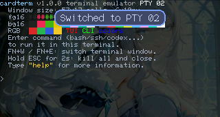
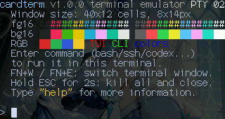

# cardterm

**English** | [简体中文](README.zh-CN.md)

**A fullscreen terminal emulator for the CardputerZero (M5Stack C154)**:
direct `/dev/fb0` rendering, PTY, Unicode bitmap fonts, multi-window, scrollback,
ANSI 16/256/truecolor, kitty keyboard protocol.


| 4×7 small font (80×24) | 6×10 default (53×17) | 8×14 large font (40×12) |
|---|---|---|
|  |  |  |

## Features

- **Customizable terminal theme** — every color of the 16-color ANSI palette, the cursor
  color and truecolor (`SGR 38;2`) are individually configurable.
- **Custom wallpaper** — PNG/JPG scaled to fill the screen, with transparent-background
  semantics (default background shows the wallpaper through).
- **TUI compatibility** — crush / opencode / codex / vim / htop / nano / nmtui and more
  render and interact correctly; alternate screen, scroll regions and redraw pacing
  behave as TUIs expect.
- **Kitty keyboard protocol (KKP)** — full support of the flags we claim, with push/pop
  and query.
- **Protocol support** — `OSC 4/10/11/12/52/110-112`, `DA1/DA2/DECXCPR/DSR/DECRQM`,
  `DECSCUSR`, `DECSTR/RIS` and friends.
- **USB / Bluetooth keyboard takeover** — onboard keyboard plus up to four external
  keyboards in parallel, standard US layout, hot-pluggable.
- **Lightweight** — extremely low memory footprint (~6 MB RSS in steady state).
- **CJK glyph support** — CJK text renders from the built-in bitmap fonts.
- **Three terminal grid sizes** — 80×24 / 53×17 / 40×12 (4×7 / 6×10 / 8×14),
  switchable per window at runtime.

Plus: 12 windows (`Ctrl+Alt+F1~F12`), scrollback & paging, toast notifications,
two-stage Esc-hold exit, customizable splash text.


## Hardware & system

- M5Stack CardputerZero (C154): CM0 (RP3A0 / BCM2710A1, aarch64), 512 MB RAM,
  1.9" ST7789v3 320×170, 46-key keyboard (TCA8418).
- Debian 13 (trixie) arm64, kernel 6.18 (`st7789v_m5stack` + `/dev/fb0`).
- Cross-build: x86_64 host + `aarch64-linux-gnu-g++` (`cmake/toolchain-aarch64.cmake`).

## Install (APPLaunch .deb)

```bash
cmake --preset aarch64-cross && cmake --build build -j"$(nproc)"
bash packaging/build-deb.sh          # → dist/cardterm_<ver>-1_arm64.deb
sudo dpkg -i dist/cardterm_1.0.0-1_arm64.deb
```

A **cardterm** launcher entry appears in APPLaunch (`/usr/share/APPLaunch/bin/cardterm`),
using the bundled icon `packaging/cardterm_100.png` (rendered from `extra/logo.svg`;
installed to `/usr/share/APPLaunch/share/images/`, referenced by absolute path in the
`.desktop` file).

## Usage

```bash
cardterm                 # launcher (type bash/ssh/… or help)
cardterm bash            # run bash in this window directly
cardterm python3         # run a REPL
cardterm ssh user@host   # run ssh
```

| Key | Action |
|---|---|
| `Ctrl+Alt+F1~F12` | Switch window (idle windows show the launcher) |
| `FN+W` / `FN+E` | Previous / next window (cycles all slots) |
| `FN+Q` | Close current terminal (like closing a tab) |
| `FN+U` / `FN+I` | Smaller / larger font for this window (4×7 / 6×10 / 8×14) |
| `Shift+PgUp/PgDn` | Scrollback by page |
| `Ctrl+Shift+↑/↓` | Scrollback by line |
| Hold `Esc` 2 s | Kill all windows and exit (SIGHUP → grace → SIGKILL) |

## Configuration

`~/.config/cardterm/config.ini` (an English-commented template is generated on first run;
unknown keys are ignored):

```ini
[general]
launch=bash                  # command run at startup with no arguments; empty = launcher
cwd=home                     # working dir: home/~/$HOME; ~/x; literal otherwise; empty = inherit
unicode=yes                  # no → LANG=C (TUIs draw ACS lines instead of wide glyphs)
full_line_newline=no         # full-width row + LF semantics (no = xterm/vt.c behavior)
toast=yes                    # transient toast notifications (switch/zoom/close/exit)
toast_ms=2000                # toast display time in ms (200–60000, clamped)

[font]
font_size=6                  # initial size for new windows: 4 = 4x7 (80x24),
                             #   6 = 6x10 (53x17), 8 = 8x14 (40x12);
                             #   change per window at runtime with FN+U / FN+I

[colors]
background_color=242424      # RRGGBB
#background_image=/path/to/image.png
#cursor=ffffff               # cursor color (RRGGBB; commented = follow bright7)
regular0..7 / bright0..7     # 16-color palette (foot defaults)

[scrollback]
lines=2000                   # values under 100 are raised to 100; capped at 30000
hold_ms=2000                 # keep a manual scroll position this long (ms) before
                             #   jumping back to the bottom; capped at 60000

[text]
splash=                      # splash text (empty = show nothing; syntax below)
```

Startup: with `launch` set, cardterm runs it automatically; the startup screen matches
the new-window screen — splash text, then `> <command>`, then the program's own prompt
with the cursor inside. With `launch` empty, you get the launcher and full control.

`[text] splash/help` color tags (not XML — only these forms are parsed; anything
malformed is printed literally): `<br>` line break; `<fgcolor=RRGGBB>…</fgcolor>`;
`<bgcolor=RRGGBB>…</bgcolor>`; an unclosed color tag lasts to the end (nesting
supported). To display a literal `<`/`>`, just write it in a non-conforming form.
Placeholders (replaced before tag parsing; unknown `<...>` kept as-is):
`<pty_id>` (e.g. `PTY 01`), `<version>` (e.g. `1.0.0`, no `v`),
`<term_size_font_size>` (e.g. `53x17 cells, 6x10px`).
The generated `config.ini` contains the built-in splash expressed with these tags,
ready to edit.

Every window can switch sizes independently with `FN+U/I`. Font details:
[docs/fonts.md](docs/fonts.md). **Full attribution, license texts and redistribution
obligations for fonts and third-party assets:
[docs/ATTRIBUTION.md](docs/ATTRIBUTION.md)**.

## Build

```bash
# Release (.deb distribution, -O3)
cmake --preset aarch64-cross && cmake --build build -j"$(nproc)"

# Debug (device-side maintenance at ~/apps/cardterm, -g -O0)
cmake --preset aarch64-debug && cmake --build build-debug -j"$(nproc)"
bash deploy.sh               # push to device over SSH and run (set PI=)
```

Dependencies: CMake ≥ 3.16, an aarch64 cross toolchain, the vendored LovyanGFX 1.3.0,
pthread/util.

`src/term_font*.h` are generated artifacts — the pre-baked tables in this repository are
all you need to build. The font regeneration pipeline (PNG/TTF/BDF → u8g2 → font tables)
is described in [docs/fonts.md](docs/fonts.md).

## Project layout

```
cardterm/
├── src/
│   ├── main.cpp / ui.cpp / session.cpp     # entry, config, 12 windows + launcher
│   ├── terminal.cpp / terminal.h           # terminal state machine / parser / rendering
│   ├── term_font.h / term_font_small.h / term_font_8x14.h
│   │                                        # 6x10 / 4x7 / 8x14 font tables (generated)
│   ├── termfont_core.h / termfont_sizes.h  # shared font-table types / sizes
│   ├── keyboard.cpp / exclusive_display.cpp
│   └── config.cpp
├── docs/                                    # attribution, keyboard analysis, feasibility notes
├── packaging/                               # .deb packaging + font licenses
├── cmake/  lib/LovyanGFX-1.3.0/
└── README.md / README.zh-CN.md
```

## Fonts & third-party assets / Credits

**Code**: MIT (see [LICENSE](LICENSE)). The vendored LovyanGFX keeps its original license
(`lib/LovyanGFX-1.3.0/license.txt`, FreeBSD / 2-clause BSD).

The three bitmap font tables (`src/term_font*.h`) are generated artifacts, baked /
subset / redrawn from the fonts below:

| Asset | Used for | License | Source |
|---|---|---|---|
| Adafruit glcdfont (via LovyanGFX Font0) | 6×10 ASCII | BSD 2-Clause | [Adafruit-GFX-Library](https://github.com/adafruit/Adafruit-GFX-Library) |
| [BoutiqueBitmap9x9](https://github.com/scott0107000/BoutiqueBitmap9x9) 1.93 | 6×10 Unicode body; 8×14 fallback | SIL OFL-1.1 (reserved name) | Cen-cyun / Luke Liu |
| [ChillBitmap](https://github.com/Warren2060/ChillBitmap) 7px | 4×7 Unicode body | SIL OFL-1.1 (reserved name) + 7px terms | warren2060 / ChillType |
| [Fusion Pixel Font](https://github.com/TakWolf/fusion-pixel-font) 10px / 8px Monospaced | 6×10 / 4×7 / 8×14 fallback | SIL OFL-1.1 | TakWolf |
| **WenQuanYi Bitmap Song 14px** | **8×14 Unicode/CJK body** | **GPL-2.0 + font exception** | [wenq.org](http://wenq.org/) / [SourceForge](https://sourceforge.net/projects/wqy/files/wqy-bitmapfont/) |
| Hand-drawn ASCII (4×6) & Latin/CP437 symbols | 4×7 ASCII; 8×14 Latin | MIT (with the project) | Hand-drawn by fsender |

**Redistribution obligations (summary)** — full copyright lines, per-item URLs and duties
in **[docs/ATTRIBUTION.md](docs/ATTRIBUTION.md)**:

- The three OFL fonts (BoutiqueBitmap9x9 / ChillBitmap / Fusion Pixel) require their
  copyright notices and the OFL text to travel with the binary — shipped in the deb at
  `/usr/share/doc/cardterm/fonts/`.
- **The 8×14 table contains WenQuanYi Bitmap Song (GPL-2.0) font data** in subset/modified
  form: distribution must include the GPL-2 text and the corresponding source of that font
  (BDF + generator script). That font data cannot be re-licensed under MIT — the cardterm
  code itself remains MIT (aggregation).
- Binary distribution must also carry the LovyanGFX FreeBSD license (which includes the
  Adafruit glcdfont BSD notice).
- The deb ships all of the above at `/usr/share/doc/cardterm/`
  (`COPYING-GPL-2.0.txt`, `WenQuanYi/source/`, LovyanGFX/Adafruit notices, `LICENSE`).

## Acknowledgements

LovyanGFX, Adafruit GFX, BoutiqueBitmap9x9, ChillBitmap, Fusion Pixel, WenQuanYi —
their authors and maintainers — and the M5Stack CardputerZero docs & community.

---

*Parts of the code in this project were generated with AI assistance.*
