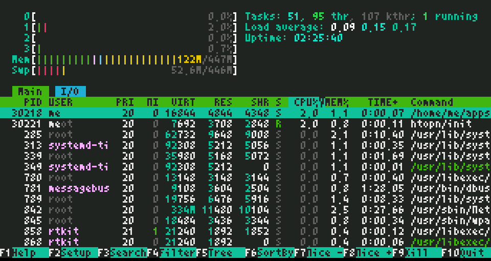
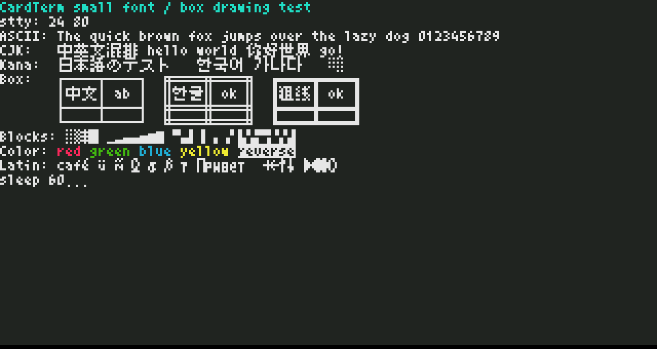

# cardterm

**CardputerZero（M5Stack C154）上的全屏终端模拟器**：`/dev/fb0` 直驱、PTY、Unicode 点阵字体
（6×10 / 4×7 / 8×14 三档）、多窗口、回滚、ANSI 16/256/真彩、kitty 键盘协议。

> **English** — cardterm is a fullscreen terminal emulator for the M5Stack CardputerZero
> (320×170 ST7789v3, Debian arm64). It drives `/dev/fb0` directly through LovyanGFX, runs
> programs on a PTY, ships three bitmap terminal fonts (6×10; a 4×7 "small" font with
> hand-drawn ASCII + ChillBitmap CJK; and an 8×14 font with hand-drawn Latin + WenQuanYi
> Bitmap Song CJK), supports 12 windows, scrollback, `xterm-256color` and the kitty
> keyboard protocol, and packs as an APPLaunch `.deb`.



| 4×7 小字体（80×24） | 6×10 默认（53×17，背景图） |
|---|---|
|  |  |

## 特性

- **纯 fbdev**：LovyanGFX → `Panel_fb` → `mmap /dev/fb0`，无 SDL/X11；屏幕 320×170 RGB565。
- **独占显示会话**：进入时冻结 APPLaunch（SIGSTOP，不杀）、静默 VT、`EVIOCGRAB` 独占键盘、
  备份整屏；退出/被信号杀掉时逐像素还原并恢复启动器。
- **PTY 终端**：`xterm-256color`、`COLORTERM=truecolor`、`TERM_PROGRAM=cardterm`；
  `winsize`/`COLUMNS`/`LINES` 跟随字体网格。
- **12 个窗口**：`Ctrl+Alt+F1~F12` 切换；内置极简启动器（`help`、任意命令）。
- **回滚**：`PgUp/PgDn`（Shift+）/`Ctrl+Shift+↑↓`，行数 `[scrollback] lines`。
- **ANSI**：SGR 16 色 / 256 色 / 38;2 真彩、反显、CUP/ED/EL、DECCKM、DEC ACS（`ESC(0`）、
  制表位、插入/擦除、REP、DA/DSR、OSC/DCS 忽略、kitty 键盘协议增强标志。
- **三档等宽点阵字体**（编译进二进制，窗口字号可单独切换）：
  - `6×10` → 53×17：glcdfont ASCII + BoutiqueBitmap9x9 + Fusion Pixel 10px 兜底；
  - `4×7` → 80×24：手绘 4×6 ASCII（4px 顶格）+ 寒蝉点阵体 ChillBitmap 8px +
    Fusion Pixel 8px 兜底，29,081 字形；圆点（●○••）手工 4×7，窄符号保持原版墨迹；
  - `8×14` → 40×12：文泉驿点阵宋体 14px（CJK 墨迹 13×13，双格）+ 手绘西文 7×13，
    另含参数化框线/方块/盲文；终端至少 8×14 才能使用该字体；
  - **制表符/方块元素按单元重绘**：6×10 竖线贯穿 10 行、4×7 贯穿 7 行，TUI 边框连续；
    象限/半块严格对半切分，`qrencode -t UTF8` 二维码可直接显示。
- **零宽字符**（VS15/16、组合符、ZWJ 等）不占格、不产生豆腐块，crush 等 TUI 的内联代码
  标记可正常显示。
- **外观**：`background_color` / `background_image`（PNG/JPG 拉伸铺满）、16 色可自定义调色板。
- 字体许可文本随 deb 安装（`/usr/share/doc/cardterm/fonts/`）。

## 硬件与系统

- M5Stack CardputerZero（C154）：CM0（RP3A0 / BCM2710A1，aarch64）、512 MB RAM、
  1.9" ST7789v3 320×170、46 键键盘（TCA8418）。
- Debian 13 (trixie) arm64，内核 6.18（`st7789v_m5stack` + `/dev/fb0`）。
- 交叉编译：主机 x86_64 + `aarch64-linux-gnu-g++`（`cmake/toolchain-aarch64.cmake`）。

## 安装（APPLaunch .deb）

```bash
cmake --preset aarch64-cross && cmake --build build -j"$(nproc)"
bash packaging/build-deb.sh          # → dist/cardterm_<ver>-1_arm64.deb
sudo dpkg -i dist/cardterm_0.4.2-1_arm64.deb
```

安装后 APPLaunch 里出现 **Cardterm** 启动项（`/usr/share/APPLaunch/bin/cardterm`），
图标为本包自带的 100×100 PNG `packaging/cardterm_100.png`（由 `extra/logo.svg` 渲染；
安装到 `/usr/share/APPLaunch/share/images/cardterm_100.png`，.desktop 的 `Icon=` 绝对路径引用）。

## 使用

```bash
cardterm                 # 启动器（输入 bash/ssh/… 或 help）
cardterm bash            # 直接在本窗口运行 bash
cardterm python3         # 运行 REPL
cardterm ssh user@host   # 运行 ssh
```

| 按键 | 作用 |
|---|---|
| `Ctrl+Alt+F1~F12` | 切换窗口（无会话的窗口显示启动器） |
| `FN+W` / `FN+E` | 上一个 / 下一个窗口（循环，不论是否活跃） |
| `FN+Q` | 关闭当前终端（类似关闭标签页） |
| `FN+U` / `FN+I` | 当前窗口字号变小 / 变大（4×7 / 6×10 / 8×14） |
| `Shift+PgUp/PgDn` | 回滚翻页 |
| `Ctrl+Shift+↑/↓` | 回滚一行 |
| 长按 `Esc` | 结束所有窗口并退出（SIGHUP → 宽限 → SIGKILL） |

## 配置

`~/.config/cardterm/config.ini`（不存在时自动生成英文注释模板；未知键忽略）：

```ini
[general]
launch=bash                  # 无参数启动时运行；留空 = 启动器
cwd=home                     # 工作目录：home/~/$HOME；~/x；其它按字面；空=继承
unicode=yes                  # no → LANG=C，TUI 用 ACS 框线
full_line_newline=no         # 满宽行 + LF 语义（no = xterm/vt.c 行为）
toast=yes                    # 事件通知（切窗/字号/关窗/退出）的 toast 叠加层开关

[font]
font_size=6                  # 新窗口初始字号：4 = 4x7（80x24），6 = 6x10（53x17），
                             #   8 = 8x14（40x12，文泉驿 14px + 手绘西文）；
                             #   运行中用 FN+U / FN+I 按窗口调整

[colors]
background_color=242424      # RRGGBB
#background_image=/path/to/image.png
#cursor=ffffff               # 光标色（RRGGBB；注释掉 = 跟随 bright7）
regular0..7 / bright0..7     # 16 色调色板（foot 默认）

[scrollback]
lines=2000                   # 少于 100 按 100 计
hold_ms=2000                 # 手动翻页后保持不跳底时长（ms）

[text]
splash=                      # 开屏文本（空 = 内置；语法见下）
help=                        # 帮助页文本（空 = 内置帮助页；结尾自动追加 '>'）
```

启动流程：默认配置会直接运行 `launch`（`bash`）；首次运行（尚无配置文件、刚生成模板）
会在命令输出之前显示开屏文本。启动器窗口（`launch` 留空时）底部提示行显示
`launch` 的第一个词（默认 `bash`），空回车即运行它，不再显示 `>`。

`[text] splash/help` 支持的颜色标签（不是 XML，只解析这几种，不合法即原样显示）：
`<br>` 换行；`<fgcolor=RRGGBB>…</fgcolor>` 前景色；`<bgcolor=RRGGBB>…</bgcolor>` 背景色；
未闭合的颜色标签生效到末尾（可嵌套）；想显示 `<`/`>` 写成不成对/不合法形式即可。
另支持占位符（在标签解析前替换，未知 `<...>` 原样保留）：`<pty_id>`（如 `PTY 01`）、
`<version>`（如 `1.0.0`，不含 `v`）、`<term_size_font_size>`（如 `53x17 cells, 6x10px`）。
默认生成的 `config.ini` 里有内置开屏文本的
等价标签写法（注释状态），可直接取消注释修改。

小字体示例（80×24，ASCII 4px）：`font_size=4`；每个窗口都可在运行时用 `FN+U/I`
单独切换字号。字体细节见 [docs/fonts.md](docs/fonts.md)，**字体/第三方资产的完整归属、
许可原文与再分发义务见 [docs/ATTRIBUTION.md](docs/ATTRIBUTION.md)**。

## 构建

```bash
# Release（.deb 分发线，-O3）
cmake --preset aarch64-cross && cmake --build build -j"$(nproc)"

# Debug（设备 ~/apps/cardterm 维护线，-g -O0）
cmake --preset aarch64-debug && cmake --build build-debug -j"$(nproc)"
bash deploy.sh               # 经 SSH 推到设备并运行（需改 PI=）
```

依赖：CMake ≥3.16、aarch64 交叉工具链、vendored LovyanGFX 1.3.0、pthread/util。

`src/term_font*.h` 为生成物，仓库直接包含烘焙好的表即可构建。字体重新生成流程
（PNG/TTF/BDF → u8g2 → 字体表）见 [docs/fonts.md](docs/fonts.md)；生成脚本
`gen_term_font.py` / `build_small_font.py` / `boxdraw.py` 与上游字体源文件体积较大，
不随本仓库分发。

## 项目结构

```
cardterm/
├── src/
│   ├── main.cpp / ui.cpp / session.cpp     # 入口、配置、12 窗口 + 启动器
│   ├── terminal.cpp / terminal.h           # 终端状态机/解析/渲染（fbcon 模型）
│   ├── term_font.h / term_font_small.h / term_font_8x14.h
│   │                                        # 6x10 / 4x7 / 8x14 字体表（生成物）
│   ├── termfont_core.h / termfont_sizes.h  # 字体表公共类型/尺寸
│   ├── keyboard.cpp / exclusive_display.cpp
│   └── config.cpp
├── docs/                                    # 字体/资产归属、fbcon/fbterm 对齐、键盘分析、可行性评估
├── packaging/                               # deb + 字体许可
├── cmake/  lib/LovyanGFX-1.3.0/  shots/
└── README.md
```

## 字体与第三方资产 / Credits

**代码**：MIT（见 [LICENSE](LICENSE)）。vendor 的 LovyanGFX 保留其原始许可
（`lib/LovyanGFX-1.3.0/license.txt`，FreeBSD / 2-clause BSD）。

三套点阵字体表均为生成物（`src/term_font*.h`），由下列字体**烘焙/子集化/重绘**而来：

| 资产 | 用途 | 许可 | 来源 |
|---|---|---|---|
| Adafruit glcdfont（经 LovyanGFX Font0） | 6×10 ASCII | BSD 2-Clause | [Adafruit-GFX-Library](https://github.com/adafruit/Adafruit-GFX-Library) |
| [BoutiqueBitmap9x9](https://github.com/scott0107000/BoutiqueBitmap9x9) 1.93 | 6×10 Unicode 主体；8×14 兜底 | SIL OFL-1.1（保留字体名） | 字言字語 Cen-cyun / Luke Liu |
| [寒蝉点阵体 ChillBitmap](https://github.com/Warren2060/ChillBitmap) 7px | 4×7 Unicode 主体 | SIL OFL-1.1（保留字体名）+ 7px 自定义条款 | warren2060 / ChillType |
| [Fusion Pixel Font](https://github.com/TakWolf/fusion-pixel-font) 10px / 8px Monospaced | 6×10 / 4×7 / 8×14 兜底 | SIL OFL-1.1 | TakWolf |
| **文泉驿点阵宋体 14px**（WenQuanYi Bitmap Song） | **8×14 Unicode/CJK 主体** | **GPL-2.0 + 字体嵌入例外** | [wenq.org](http://wenq.org/) / [SourceForge](https://sourceforge.net/projects/wqy/files/wqy-bitmapfont/) |
| 手绘 ASCII（4×6）与西文/CP437 符号 | 4×7 ASCII；8×14 西文 | MIT（随项目） | cardterm 作者 |

**再分发义务摘要**（完整清单、版权行、逐项 URL 与义务见
**[docs/ATTRIBUTION.md](docs/ATTRIBUTION.md)**）：

- 三份 OFL 字体（BoutiqueBitmap9x9 / ChillBitmap / Fusion Pixel）的版权与 OFL 原文必须随
  二进制分发——已随 deb 安装到 `/usr/share/doc/cardterm/fonts/`
  （[packaging/fonts/](packaging/fonts/)，其中 `NOTICE.md` 的部分说明已过时，以 ATTRIBUTION 为准）。
- **8×14 表包含文泉驿点阵宋体（GPL-2.0）的字体数据**，且是子集化/重绘后的修改版：
  分发时必须附 GPL-2 文本，并提供该字体的对应源码（BDF/生成脚本）或书面提供承诺；
  该字体数据不能按 MIT 单独再许可（cardterm 代码本身仍是 MIT，属聚合关系）。
- 二进制分发还需随附 LovyanGFX 的 FreeBSD 许可（其中已含 Adafruit glcdfont 的 BSD 段）。
- 当前 deb 尚缺：文泉驿 GPL-2 文本与源码提供方式、LovyanGFX/Adafruit BSD 通知、
  cardterm 自己的 `copyright` 文件——**开源发布前需补齐**，详见 ATTRIBUTION §4。

## 致谢

LovyanGFX、Adafruit GFX、BoutiqueBitmap9x9、ChillBitmap、Fusion Pixel、文泉驿（WenQuanYi）
各上游字体的作者与维护者，以及 M5Stack CardputerZero 文档与社区。
