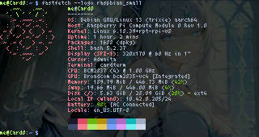
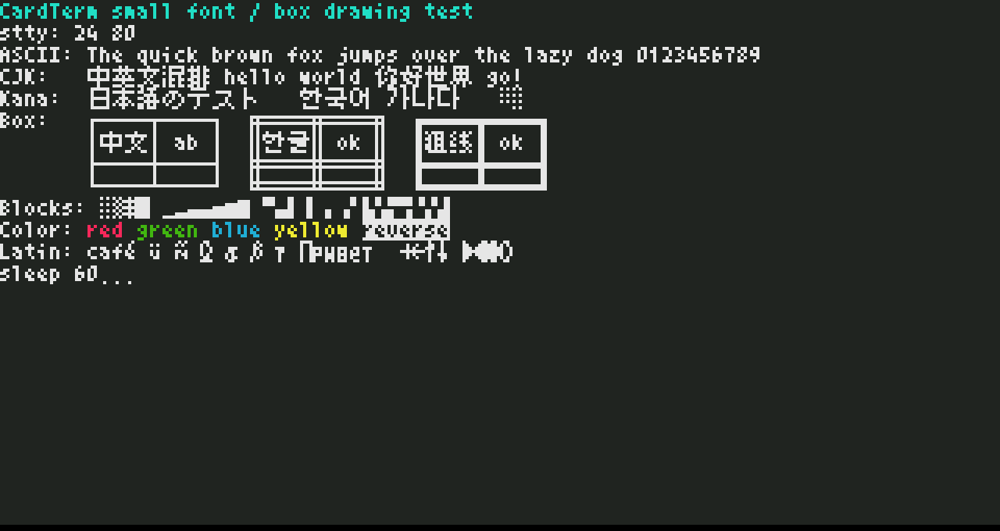
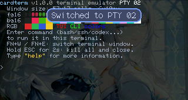
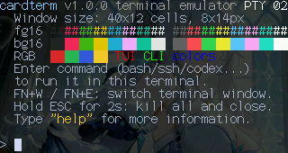
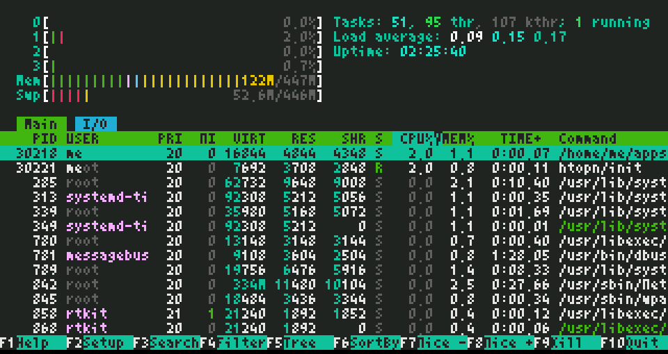

# cardterm

[English](README.md) | **简体中文**

**CardputerZero（M5Stack C154）上的全屏终端模拟器**：`/dev/fb0` 直驱、PTY、Unicode 点阵字体、
多窗口、回滚、ANSI 16/256/真彩、kitty 键盘协议。



| 4×7 小字体（80×24） | 6×10 默认（53×17） | 8×14 大字体（40×12） |
|---|---|---|
|  |  |  |

## 特性

- **极高性能和极低内存占用**：稳态约 6MB，12 窗口多开会话可控（真机实测基线
  5.4–6.4MB；启用中文输入时 rime 引擎常驻约 +16MB），直驱 /dev/fb0，
  秒启动，字符渲染更快速。
- **自定义终端主题颜色和 PNG/JPG 背景图**：16 色 ANSI 调色板逐色可配、光标色、
  真彩（`SGR 38;2`）；背景图拉伸铺满、透明背景语义。
- **TUI 兼容性**：codex / opencode / crush / vim / htop / nano 等 TUI 实测渲染与交互
  正常；备用屏、滚动域、重绘节拍良好。
- **复杂协议支持**：kitty 键盘协议 (KKP)、`DA1/DA2/DECXCPR/DSR/DECRQM`、
  `DECSCUSR`、`DECSTR/RIS`、`OSC 4/10/11/12/52/110-112`（110/111/112 依次复位
  默认前景/背景/光标色，与 xterm ctlseqs 一致）。
- **USB/蓝牙外接键盘接管**：板载 + 最多 4 个外接并行、标准 US 键位、热插拔。
- **多窗口**（`Ctrl+Alt+F1~F12`）、回滚/翻页、三档终端大小（80×24 / 53×17 / 40×12）、
  toast 事件通知。
- **后台会话支持**：把会话和程序挂载至后台运行，退出 cardterm 后可恢复——
  `Fn+A`（外接键盘 `Super+A`）剥离、重开自动接回，剥离期间的输出文本贴回滚动区
  （纯文本，上限 `[background] buffer_kb`，默认 256KB）。
- **单 config.ini 配置文件**：主题配色方案、初始命令和工作目录、回滚行数、
  窗口数、启动横幅文本等多个配置项。
- **CJK 字形支持**：中文/日文等 CJK 文本由内置点阵字体渲染。

另有：长按 Esc 两段式退出、`Fn+H` 快捷帮助、开屏文本可自定义。



## 硬件与系统

- M5Stack CardputerZero（C154）：CM0（RP3A0 / BCM2710A1，aarch64）、512 MB RAM、
  1.9" ST7789v3 320×170、46 键键盘（TCA8418）。
- Debian 13 (trixie) arm64，内核 6.18（`st7789v_m5stack` + `/dev/fb0`）。
- 交叉编译：主机 x86_64 + `aarch64-linux-gnu-g++`（`cmake/toolchain-aarch64.cmake`）。

## 安装（APPLaunch .deb）

```bash
cmake --preset aarch64-cross && cmake --build build -j"$(nproc)"
bash packaging/build-deb.sh          # → dist/cardterm_<ver>-1_arm64.deb
sudo dpkg -i dist/cardterm_1.3.0-1_arm64.deb
```

安装后 APPLaunch 里出现 **cardterm** 启动项（`/usr/share/APPLaunch/bin/cardterm`），
图标为本包自带的 PNG（由 `extra/logo.svg` 渲染；安装到
`/usr/share/APPLaunch/share/images/`，.desktop 的 `Icon=` 以绝对路径引用）。

## 使用

```bash
cardterm                 # 启动器（输入 bash/ssh/… 或 help）
cardterm bash            # 直接在本窗口运行 bash
cardterm python3         # 运行 REPL
cardterm ssh user@host   # 运行 ssh
```

| 按键 | 作用 |
|---|---|
| `Ctrl+Alt+F1~F12` | 切换窗口（无会话的窗口显示启动器） |
| `Fn+W` / `Fn+E` | 上一个 / 下一个窗口（循环，不论是否活跃） |
| `Fn+Q` | 关闭当前终端（类似关闭标签页） |
| `Fn+U` / `Fn+I` | 当前窗口字号变小 / 变大（4×7 / 6×10 / 8×14） |
| `Fn+A` / `Super+A` | 剥离当前会话到后台持续运行（重开 cardterm 自动接回） |
| `Fn+H` / `Super+H` | 在空闲窗口显示帮助页（当前窗口已空则就地显示） |
| `Shift+PgUp/PgDn` | 回滚翻页 |
| `Ctrl+Shift+↑/↓` | 回滚一行 |
| 长按 `Esc` 2 秒 | 结束所有窗口并退出（SIGHUP → 宽限 → SIGKILL；已剥离会话不受影响） |

## 配置

`~/.config/cardterm/config.ini`（不存在时自动生成英文注释模板；未知键忽略）：

```ini
[general]
launch=bash                  # 无参数启动时运行；留空 = 启动器
cwd=home                     # 工作目录：home/~/$HOME；~/x；其它按字面；空=继承
windows=12                   # 终端窗口槽位数（2–32，默认 12）；直切快捷键超过此数仅弹 toast 提示
unicode=yes                  # no → LANG=C，TUI 用 ACS 框线
full_line_newline=no         # 满宽行 + LF 语义（no = xterm/vt.c 行为）
toast=yes                    # 事件通知（切窗/字号/关窗/退出）的 toast 叠加层开关
toast_ms=2000                # toast 显示时长 ms（200–60000，超限钳位）

[font]
font_size=6                  # 新窗口初始字号：4 = 4x7（80x24），6 = 6x10（53x17），
                             #   8 = 8x14（40x12）；运行中用 Fn+U / Fn+I 按窗口调整

[colors]
background_color=242424      # RRGGBB
#background_image=/path/to/image.png
#cursor=ffffff               # 光标色（RRGGBB；注释掉 = 跟随 bright7）
regular0..7 / bright0..7     # 16 色调色板（foot 默认）

[scrollback]
lines=2000                   # 少于 100 按 100 计；上限 30000
hold_ms=2000                 # 手动翻页后保持不跳底时长（ms，上限 60000）

[background]
buffer_kb=256                # 后台会话恢复时贴回的输出文本上限（16–4096 KB，
                             #   默认 256，最多存 4MB 历史；纯文本贴回，节省内存）

[text]
splash=                      # 开屏文本（空 = 不显示；语法见下）
```

启动流程：配置了 `launch` 时自动运行它，启动显示与新建窗口一致——先开屏文本，
再 `> 命令`，换行后是程序自己的提示符（光标在其中）；`launch` 留空则进入启动器。

`[text] splash` 支持的颜色标签（不是 XML，只解析这几种，不合法即原样显示）：
`<br>` 换行；`<fgcolor=RRGGBB>…</fgcolor>` 前景色；`<bgcolor=RRGGBB>…</bgcolor>` 背景色；
未闭合的颜色标签生效到末尾（可嵌套）；想显示 `<`/`>` 写成不成对/不合法形式即可。
另支持占位符（在标签解析前替换，未知 `<...>` 原样保留）：`<pty_id>`（如 `PTY 01`）、
`<version>`（如 `1.0.0`，不含 `v`）、`<term_size_font_size>`（如 `53x17 cells, 6x10px`）。
默认生成的 `config.ini` 里有内置开屏文本的等价标签写法，可直接编辑。

每个窗口都可在运行时用 `Fn+U/I` 单独切换字号。字体细节见 [docs/fonts.md](docs/fonts.md)，
**字体/第三方资产的完整归属、许可原文与再分发义务见
[docs/ATTRIBUTION.md](docs/ATTRIBUTION.md)**。

## 构建

```bash
# Release（.deb 分发线，-O3）
cmake --preset aarch64-cross && cmake --build build -j"$(nproc)"

# Debug（设备 ~/apps/cardterm 维护线，-g -O0）
cmake --preset aarch64-debug && cmake --build build-debug -j"$(nproc)"
bash deploy.sh               # 经 SSH 推到设备并运行（需改 PI=）
```

依赖：CMake ≥3.16、aarch64 交叉工具链、vendored LovyanGFX 1.3.0、pthread/util。

`src/term_font*.h` 为生成物，仓库直接包含烘焙好的表即可构建。字体重新生成流程
（PNG/TTF/BDF → u8g2 → 字体表）见 [docs/fonts.md](docs/fonts.md)。

## 项目结构

```
cardterm/
├── src/
│   ├── main.cpp / ui.cpp / session.cpp     # 入口、配置、12 窗口 + 启动器
│   ├── terminal.cpp / terminal.h           # 终端状态机/解析/渲染
│   ├── term_font.h / term_font_small.h / term_font_8x14.h
│   │                                        # 6x10 / 4x7 / 8x14 字体表（生成物）
│   ├── termfont_core.h / termfont_sizes.h  # 字体表公共类型/尺寸
│   ├── keyboard.cpp / exclusive_display.cpp
│   └── config.cpp
├── docs/                                    # 字体/资产归属、键盘分析、可行性评估
├── packaging/                               # deb + 字体许可
├── cmake/  lib/LovyanGFX-1.3.0/
└── README.md / README.zh-CN.md
```

## 字体与第三方资产 / Credits

**代码**：MIT（见 [LICENSE](LICENSE)）。vendor 的 LovyanGFX 保留其原始许可
（`lib/LovyanGFX-1.3.0/license.txt`，FreeBSD / 2-clause BSD）。

三套点阵字体表均为生成物（`src/term_font*.h`），由下列字体**烘焙/子集化/重绘**而来：

| 资产 | 用途 | 许可 | 来源 |
|---|---|---|---|
| Adafruit glcdfont（经 LovyanGFX Font0） | 6×10 ASCII | BSD 2-Clause | [Adafruit-GFX-Library](https://github.com/adafruit/Adafruit-GFX-Library) |
| [BoutiqueBitmap9x9](https://github.com/scott0107000/BoutiqueBitmap9x9) 1.93 | 6×10 Unicode 主体；8×14 兜底 | SIL OFL-1.1（保留字体名） | 字言字語 Cen-cyun / Luke Liu |
| [寒蝉点阵体 ChillBitmap](https://github.com/Warren2060/ChillBitmap) 7px | 4×7 Unicode 主体 | SIL OFL-1.1（保留字体名）+ 7px 自定义条款 | warren2060 / ChillType |
| [Fusion Pixel Font](https://github.com/TakWolf/fusion-pixel-font) 10px / 8px Monospaced | 6×10 / 4×7 / 8×14 兜底 | SIL OFL-1.1 | TakWolf |
| **文泉驿点阵宋体 14px**（WenQuanYi Bitmap Song） | **8×14 Unicode/CJK 主体** | **GPL-2.0 + 字体嵌入例外** | [wenq.org](http://wenq.org/) / [SourceForge](https://sourceforge.net/projects/wqy/files/wqy-bitmapfont/) |
| 手绘 ASCII（4×6）与西文/CP437 符号 | 4×7 ASCII；8×14 西文 | MIT（随项目） | Hand-drawn by fsender |

**再分发义务摘要**（完整清单、版权行、逐项 URL 与义务见
**[docs/ATTRIBUTION.md](docs/ATTRIBUTION.md)**）：

- 三份 OFL 字体（BoutiqueBitmap9x9 / ChillBitmap / Fusion Pixel）的版权与 OFL 原文必须随
  二进制分发——已随 deb 安装到 `/usr/share/doc/cardterm/fonts/`。
- **8×14 表包含文泉驿点阵宋体（GPL-2.0）的字体数据**，且是子集化/重绘后的修改版：
  分发时必须附 GPL-2 文本，并提供该字体的对应源码（BDF/生成脚本）；该字体数据不能按
  MIT 单独再许可（cardterm 代码本身仍是 MIT，属聚合关系）。
- 二进制分发还需随附 LovyanGFX 的 FreeBSD 许可（其中已含 Adafruit glcdfont 的 BSD 段）。
- deb 已随包补齐上述材料（`/usr/share/doc/cardterm/`：`fonts/WenQuanYi/COPYING-GPL-2.0.txt`、
  `fonts/WenQuanYi/source/`、LovyanGFX/Adafruit 通知、`LICENSE`）。

## 致谢

LovyanGFX、Adafruit GFX、BoutiqueBitmap9x9、ChillBitmap、Fusion Pixel、文泉驿（WenQuanYi）
各上游字体的作者与维护者，以及 M5Stack CardputerZero 文档与社区。

---

*本项目部分代码由 AI 生成。*
